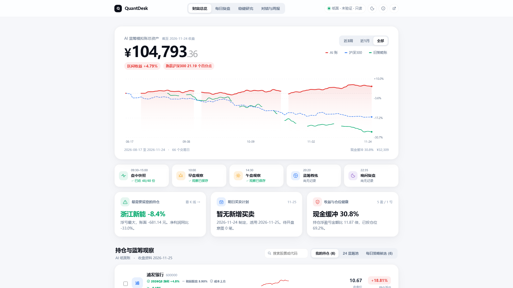
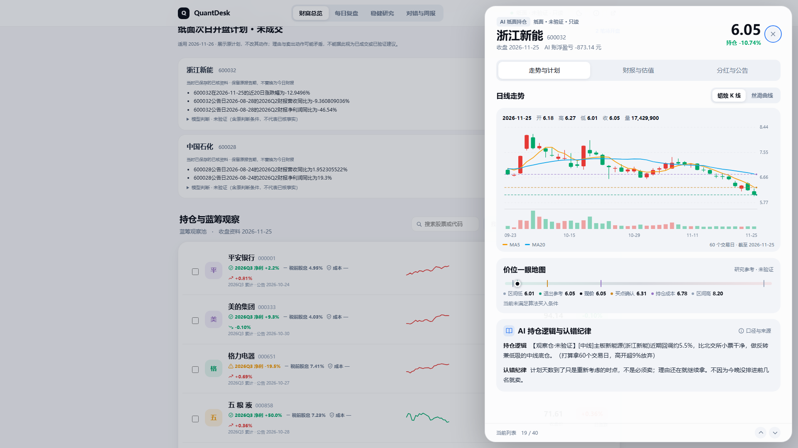
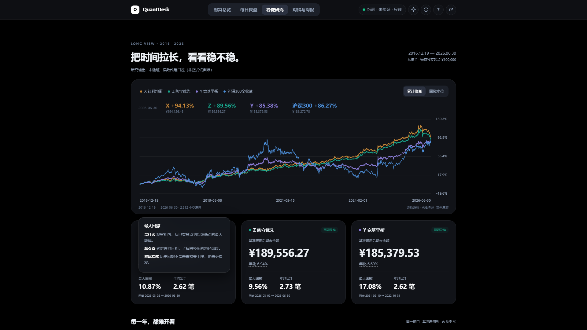
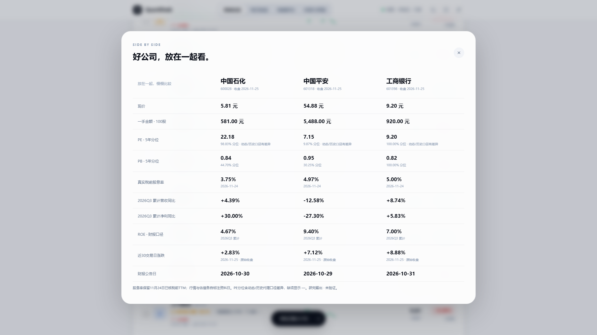

# QuantDesk

**AI-Assisted Paper-Only A-Share Quantitative Research & Daily Review Workbench**


> [!IMPORTANT]
> **Compliance & Safety Boundary (`CHARTER.md` §2)**
> - **Paper-only & research-only**: Zero brokerage integration, zero real order execution, zero live trading credentials.
> - **Offline-first by default**: `network=false` unless explicitly enabled; all UI and review endpoints enforce read-only access.
> - **Sanitized source mirror**: This repository tracks pure source code, tests, documentation, and UI previews only. Local market datasets (`data/`), paper ledgers (`state/`), runtime logs (`logs/`), and local environment configs (`config/`) are strictly excluded.

---

## Interface Previews

### 1. Wealth Overview & Dual-Ledger Tracking
Dual-track comparison between the LLM AI paper ledger, deterministic rule strategy ledger, and CSI 300 benchmark, paired with five daily automation checkpoints (intraday snapshots, morning/afternoon observation, blue-chip coach, evening review).



### 2. Stock Drawer · K-Line & AI Position Logic
Candlestick chart with MA5/MA20, algorithmic reference levels, and recorded AI holding rationale & stop-loss discipline.



### 3. 9.5-Year Cross-Asset ETF Study (OLED Dark Mode)
Long-horizon (2016–2026, 2,312 trading days) multi-asset drawdown and return comparison with interactive metric cards.



### 4. Side-by-Side Core Blue-Chip Comparison
Multi-stock comparison across PE/PB 5-year percentiles, dividend yields, quarterly revenue/net-profit YoY, and ROE.



---

## Core Architecture & Engineering Highlights

| Pillar | Implementation |
|---|---|
| **Dual-Ledger Comparison** | Runs a deterministic rule-based strategy paper book alongside an LLM-driven AI paper trader book to separate reproducible rule logic from qualitative LLM reasoning. |
| **Anti-Hallucination Guard** | Every price, percentage change, and timestamp stated in an LLM decision is programmatically cross-checked against raw local market snapshots; unverified or mismatched statements are rejected automatically. Forecasts are timestamp-sealed before outcomes occur. |
| **Strict Market Rule Gating** | Paper matching enforces A-share constraints: next-open/next-slot fills, adverse slippage, limit-up buy rejection, limit-down sell rejection, T+1 rules, suspension freezes, and board eligibility filters. |
| **Read-Only 60fps Terminal (`ui_preview/`)** | Zero-framework vanilla JS + Canvas rendering engine with light/OLED-dark themes, 5-minute onboarding modal, 26 plain-language hover glossary cards, and three-segment valuation seam auditing. |
| **Intraday + Post-Market AI Prototype (`prototypes/intraday_ai_trader/`)** | Modular 5-file offline-first paper trader prototype supporting two-stage intraday radar inspection, shadow ledger replay across 48 daily market snapshots, and automated end-of-day review diaries. |
| **Governance & Testing** | Governed by [CHARTER.md](CHARTER.md) and backed by 500+ automated test modules covering ledger accounting reconciliation, limit-price gates, data-chain integrity, and frontend read-only contracts. |

---

## Repository Structure

```text
QuantDesk/
├── quantdesk/                 # Core research engine, matching rules, backtest & data store
├── ai_trader/                 # LLM paper trader, anti-hallucination validator & review runner
├── app/                       # Main local research web workbench (port 8000, read-only)
├── ui_preview/                # Minimal 60fps Apple/Linear-style read-only terminal (v6.1)
├── prototypes/
│   └── intraday_ai_trader/    # Full-market intraday + post-market AI paper trader prototype
├── scripts/                   # CLI entrypoints (scripts/qd.py), data health & scheduled runners
├── prompts/                   # Structured prompt templates for review & stock coaching
├── tests/                     # 500+ unit, contract, accounting & regression tests
├── docs/                      # Architecture docs, guides & sanitized UI screenshots
├── CHARTER.md                 # Project invariants & paper-only safety constitution
└── pyproject.toml             # Python project configuration & dependencies
```

---

## Local Quickstart (Offline / Read-Only)

```powershell
# 1. Create virtual environment & install dependencies
python -m venv .venv
.\.venv\Scripts\Activate.ps1
pip install -r requirements.txt

# 2. Point to your local data workspace (kept outside this repo)
$env:QUANTDESK_ROOT = "path\to\your\local\quantdesk_workspace"

# 3. Launch the main research workbench (offline, read-only, port 8000)
python scripts/qd.py app

# 4. Or launch the minimal 60fps read-only preview terminal (port 8035)
python -B ui_preview/server.py --port 8035

# 5. Run offline test suite
pytest -q
```

---

## Disclaimer

This repository is strictly for personal research, software engineering practice, and paper-trading methodology verification. Nothing in this codebase connects to a broker, places real trades, or constitutes financial or investment advice.
