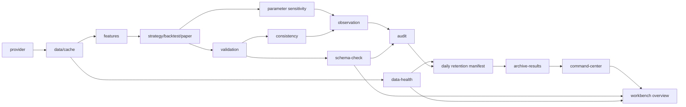

# QuantDesk Architecture

## Active Stack (Round 21, 2026-08-13)

- **Primary stack**: `scripts/quant_api_server.py` (port **8000**, Flask) with
  `app/templates/daily_research.html` + `app/static/js/daily_research.js`.
  All new UI/API work goes here.
- **Companion compatibility stack**: `python -m ai_trader app` (port **8001**)
  remains supported for the AI paper trader classroom, while 8000 stays the
  main product entry.
- **Frozen stack**: `scripts/quant_app_server.py` (port 8765) and
  `app/static/app.js` are frozen. The legacy paper trade routes
  `/api/paper-buy` and `/api/paper-sell` return HTTP 410 Gone and never write
  any portfolio file. Do not add features to the 8765 stack.
- **Canonical paper ledger**: `state/auto_paper_portfolio.json`. Only the
  daily workflow / conditional-execution path writes it. Stage4 tri-account
  replay accounts are synthetic research accounts, not the user ledger.
- This section aligns with `ALIGNMENT.md` and `docs/CURRENT_STATE.md`
  ("30 秒对齐"); if they diverge, fix all three in the same change.

## v3.4.5.1 Engineering Docs And Package Grouping Lite

Stage v3.4.5.1 adds low-risk package indexes under `quantdesk/research/`,
`quantdesk/intraday/`, `quantdesk/paper/`, and `quantdesk/agent/` while keeping
legacy top-level imports stable. `quantdesk/backtest_loaders.py` owns local
benchmark and industry-map loading helpers; `quantdesk/backtest.py` re-exports
them for compatibility. `quantdesk/self_check_render.py` owns self-check output
formatting without changing pass/warn/fail logic.

This document describes the current architecture without changing code layout. The project intentionally avoids a large directory refactor while v3.x stabilizes diagnostics, manifests, and command governance.

Historical notes below that mention `app/index.html`, `app/static/app.js`, or
`quant_app_server.py` are legacy 8765 architecture markers only. They are not
current launch or operator instructions.

## v3.4.2.2 Clean Zip Bootstrap And Calendar Source

Clean zip first-run flow starts with `doctor`, then `data-bootstrap`, then
`data-health` and `daily`. `data-bootstrap --network false` only initializes the
tiny demo universe; real daily bars require optional data dependencies and
explicit `--enable-network`.

The canonical A-share calendar source is
`data/calendar/a_share_trading_calendar.csv`. `config/trading_calendar_cn.yaml`
is legacy optional fallback, and `BUILTIN_CN_HOLIDAYS` is deprecated fallback
used only when local calendar files are missing.

## v3.4.2.1 Dependency And Provider Hygiene

Core runtime dependencies live in `requirements.txt` and `pyproject.toml`.
Optional live-data provider packages live in `requirements-data.txt` and the
`data` optional dependency group. The default trading calendar path is
`data/calendar/a_share_trading_calendar.csv`.

Automatic paper-portfolio state writes are protected by a local advisory lock
derived from `state/auto_paper_portfolio.json`. Planned providers keep
`status=planned` / `placeholder=true` and are not counted as real provider
failures.

## v3.4.2 Dashboard State Clarity

The workbench state layer now carries `analysis_pool_count`, `selected_count`, `max_symbols`, `truncated`, and `truncation_reason` from scope resolution through data-update, data-health, and market-intel payloads. The UI uses those fields to distinguish “current analysis pool size” from “symbols checked in this run”.

The left sidebar intentionally separates current data status, latest market-intel report, and latest daily review. This prevents stale daily artifacts from being presented as current market observation state. Remediation also separates offline checks from online data repair; stale daily data points to explicit `--enable-network` repair commands while preserving offline checks for diagnosis.

## v3.3.4 Patch Notes

- `quantdesk/daily_output_summary.py` converts daily workflow payloads into a short console summary and `daily_console_summary` dict.
- `scripts/run_daily_workflow.py` prints the summary by default; `--json true` / `--verbose true` prints the full JSON.
- `quantdesk/daily_workflow_orchestrator.py` standardizes daily artifacts as `reports/daily_quant_report_latest.md` and `results/daily_workflow_latest.json`.
- `quantdesk/status_advisor.py`, `quantdesk/command_center_status.py`, and `quantdesk/workbench_overview.py` read daily report/result paths so status, command-center, and artifact center form one daily follow-through path.
- Scope remains output/UX only: no strategy changes, no score change, no backtest return change, no broker API, no real order, no default network, no default LLM, no investment advice.

## v3.3.3 Patch Notes

- `quantdesk/status_advisor.py` builds the read-only `qd.py status` summary from local result files and operation_log.
- `scripts/qd.py` remains the recommended entrypoint and now groups help output around beginner, validation, maintenance, and advanced commands.
- `quantdesk/daily_workflow_orchestrator.py` appends `guardrail_summary` to daily workflow results by default; quick guardrails are warnings only and do not alter strategy logic, scoring, parameters, or backtest return calculation.
- `quantdesk/time_utils.py` centralizes timestamp helpers used by recent v3 modules.
- `docs/script_entrypoint_inventory.md` records retained/internal/deprecated bare scripts so entrypoint cleanup can continue safely.

## v3.3.2.4 Patch Notes

- `quantdesk/workbench_overview.py` now tags next actions by category so the UI can separate data, validation, review, and system prompts without changing the underlying status contract.
- `app/static/app.js` localizes workbench metric/status labels and renders categorized “我现在该做什么” action cards.
- This patch remains presentation-only: workbench GET APIs stay read-only and do not trigger provider calls, workflows, LLMs, or trading actions.

## v3.3.2.3 Patch Notes

- `quantdesk/data_update_orchestrator.py` now exposes `effective_target_date` and `target_date_source` so explicit `--target-date` stays distinguishable from automatic complete-trading-day inference.
- `quantdesk/workbench_overview.py` reads current nested data-health payloads (`freshness`, `intraday`, provider summaries) and produces friendlier next actions for stale daily data, missing intraday data, and stale validation/report outputs.
- `app/index.html` / `app/static/app.js` add a read-only 今日工作台 refresh path and render 命令中心 command groups as tables rather than cramped cards.

## v3.3.2.2 Patch Notes

- `quantdesk/trading_calendar.py` now caches calendar CSV loads by path and exposes `clear_calendar_cache()` for tests; weekend-only fallback and provisional calendar metadata remain unchanged.
- `scripts/self_check.py` uses real module/file capability checks for the data freshness gate, shared candidate contract, and intraday 1m closure instead of relying on historical comments in `quantdesk/version.py`.
- `quantdesk/data_provider_registry.py` marks route-map placeholder providers as `planned` / `placeholder=true`; `quantdesk/provider_failure_stats.py` treats those rows as planned/skipped rather than true failures.
- `pyproject.toml` declares core runtime dependencies so `pip install .` has pandas/numpy available without pulling optional provider stacks into the core install.

## Layers

- `core/version/config`: `quantdesk/version.py`, `config/default.yaml`, `pyproject.toml`.
- `providers`: provider contracts, provider matrix, Tencent/mootdx/AKShare-style adapters, smoke diagnostics.
- `data/calendar/cache`: local A-share calendar, daily/intraday cache, low-price learning pool, data health freshness / intraday coverage / data_grade trend.
- `strategy/backtest/paper`: strategy demo, backtest, historical replay, paper portfolio, conditional plans.
- `validation/audit`: strategy validation, execution assumption guard, paper/backtest consistency, feature audit, statistical validation, parameter sensitivity audit, schema contract validation, report audit.
- `schema/contracts`: `quantdesk/schema_contracts.py` defines common result payload fields and status semantics; `quantdesk/result_payload_validator.py` reads latest runtime JSON files for schema/status/warnings/disclaimer and secret-leak checks.
- `agent/llm`: observation contract, safe bridge, policy guard, evidence pack, hallucination guard, optional LLM providers.
- `chanlun`: knowledge base, fractal, bi, segment learning modules.
- `ui/daily_research`: `scripts/quant_api_server.py`, `app/templates/daily_research.html`, and `app/static/js/daily_research.js` provide the active 8000 read-only research dashboard and AI paper trader integration surfaces.
- `ui/ai_trader_compat`: `scripts/server/routes/ai_trader.py`, `ai_trader/dashboard.py`, and `python -m ai_trader app` provide the supported 8001 compatibility classroom without broker routing or real-order capability.
- `scripts/cli`: `scripts/qd.py` as the recommended entrypoint plus advanced helper scripts.
- `results/reports`: runtime artifacts excluded from clean zip.

## Key Path

## Failure Effects

- Provider skipped/failed: downstream data may be missing; reports must show skipped/failed instead of fake success.
- Daily data missing: feature audit returns warning and observation confidence is lower.
- Intraday missing: strategy validation cannot verify reliable intraday execution.
- Validation failed: observation report must warn that strategy conclusions are not reliable.
- Consistency warning: paper simulation and backtest should be treated as learning-only.
- Parameter sensitivity warning: robustness is uncertain; reports must not treat stable or high-scoring parameter points as recommended parameters.
- Schema-check warning: a latest result file may be missing, have missing common fields, contain an illegal status, or show possible secret-like text. Missing files are normal in clean zip environments; secret leaks should block release cleanup.
- Manifest hash mismatch: reproducibility is not established.
- Operation log empty: command center can only show missing status until commands run.
- Workbench missing cards: clean zip excludes `results/`, `reports/`, `data/daily/`, and `data/intraday/`; the UI should show missing/warning empty states and suggest data/process commands rather than showing red program failure.

## Workbench UI

v3.3.1 keeps the existing frontend stack and avoids a React/Vue rewrite. The UI is organized as a collapsible left sidebar plus a main work area:

- 首页 / 今日工作台: six status cards, the linear daily workflow, and at most three next actions.
- 数据健康、数据留存、策略验证、纸面组合、学习复盘: existing functions grouped by workflow stage.
- 产物中心: read-only grouped artifact list for latest JSON/Markdown outputs.
- 命令中心: independent page for recent command status and grouped commands; it is no longer rendered as a full command panel at every page top.
- 新手模式 / 专家模式: stored in `quantdesk.ui.mode`; sidebar collapse state is stored in `quantdesk.sidebar.collapsed`.

## Boundary

QuantDesk does not connect to brokers, does not place real orders, does not save real account information, does not promise returns, and does not constitute investment advice. `network=false` and LLM disabled remain defaults.
## v3.3.2 Data Update Workbench

新增 `quantdesk/data_update_orchestrator.py` 作为数据更新编排层。它默认只读检查本地 `data/daily`，只有显式 `network=true` / `--enable-network` 时才复用现有 `daily_price_update_engine.update_daily_prices`。该层不新增 provider 协议，不接券商，不真实下单，不默认扫描全 A。

相关入口：

- CLI：`scripts/run_data_update.py`、`scripts/dev_preflight.py`、`scripts/qd.py data-update`、`scripts/qd.py dev-preflight`
- API：`GET /api/workbench/data-update` 只读；`POST /api/workbench/data-update/run` 默认离线，显式 network=true 才允许更新。
- UI：左侧栏“数据更新”工作台。
- 产物：`results/data_update/data_update_latest.json`、`reports/data_update_report_latest.md`。
# v3.3.2.5 Workbench State Consistency

工作台聚合层保持只读：`/api/workbench/overview` 同时读取 data-update 与 data-health latest 文件，但不会把两者的计数互相覆盖。`validate_workbench_state_consistency` 会检查 target date、`data_scope` 和 symbols 子集关系；不一致时首页提示重新运行 data-health。产物中心只读取固定 results/reports 路径，missing 显示为未生成，不读取密钥配置。

schema-check 的 secret 扫描在 `result_payload_validator.py` 中分级为 `confirmed_secret_leak` 与 `secret_like_reference`，避免 provider_secrets.json/llm_config.json 路径名误报为高风险。所有工作台 API 默认 `network=false`，不调用 LLM，不接券商，不真实下单，不构成投资建议。
## v3.3.5 remediation advisor

`quantdesk/remediation_advisor.py` is a local-only translation layer between warning payloads and user-facing repair commands. It reads existing result files or in-memory payloads, classifies warning kinds, ranks at most five actions, and writes `results/fix_plan_latest.json` for `qd.py fix-plan`.

The module is intentionally downstream of data-update, data-health, daily, schema-check, and command-center. It does not fetch data, call LLMs, change strategy parameters, alter scoring, or modify backtest return logic.

## v3.3.6 remediation UI layer

Release: v3.3.6 Remediation Ui Copy And Artifact Preview Polish

The remediation UI layer remains a thin read-only presentation layer over `remediation_actions` and artifact metadata. `app/static/app.js` now centralizes command copy and display helpers (`copyTextToClipboard`, `renderCopyCommandButton`, `renderCommandBlock`, `showCopyToast`) so home, command-center, and artifact-center use the same wording and long-command behavior.

The UI groups commands as offline or explicitly networked, but it never runs them automatically. Artifact previews are generated from existing JSON/Markdown files only; secret config files are not read. The architecture boundary stays unchanged: no broker connection, no real orders, no default network, no default LLM, no strategy or backtest return changes, and no investment advice.
## v3.3.7 Patch Notes

- `quantdesk/symbol_display_utils.py` provides display-only helpers for symbol previews and long `--symbols` command shortening.
- `scripts/run_data_update.py` and `scripts/run_data_health_dashboard.py` print short summaries by default; full JSON remains in latest result files and can be printed with `--json true` / `--verbose true`.
- `app/static/app.js` and `app/static/styles.css` add long-command, long-path, and mobile/narrow-screen overflow safeguards for the workbench, command center, artifact center, and remediation blocks.
- Scope remains presentation-only: no strategy changes, no score change, no return logic change, no broker API, no real order, no default network, no default LLM, no investment advice.
## Market Intelligence Layer

v3.4.0 adds a read-only market intelligence layer:

- `market_regime_observer.py`: local market regime and breadth observation.
- `sector_theme_observer.py`: local sector/theme hotness from mapped samples.
- `market_news_observer.py`: offline-by-default news observation; `network=false` returns skipped.
- `sector_low_price_candidate_selector.py`: low-price paper-observation candidates.
- `scenario_curve_builder.py`: scenario observation curves, explicitly not prediction.
- `market_intelligence_workbench.py`: orchestrates the above modules.

The layer reads local files, writes JSON/Markdown artifacts, and integrates with `qd.py`, command-center, artifact center, archive-results, and schema-check. It does not connect to brokers, does not place orders, does not fabricate missing market/news data, and does not constitute investment advice.
## v3.4.1 Scope Policy

`quantdesk/scope_policy.py` centralizes daily workflow scope resolution for data-update, data-health, and market-intel. The policy chooses explicit symbols first, respects explicit scope, defaults to `current_analysis_pool`, falls back to the included low-price pool when needed, and never silently uses full-A.

Workbench overview compares scope metadata from latest data-update, data-health, and market-intel payloads and surfaces mismatch remediation commands. Frontend cards use summarized symbol previews to avoid long-list overflow.
