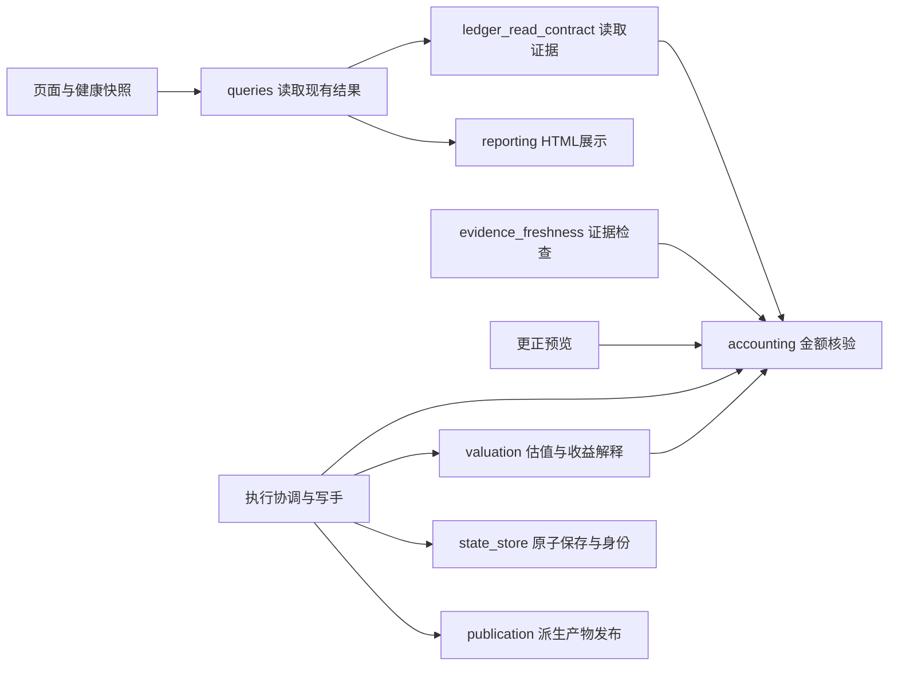

# QuantDesk Paper

Research-only paper/account-book package index. It has no broker connection and
does not place real orders.

`matching.py` is the shared fill-policy *declaration* table, not a finished
matching engine. Each paper ledger header declares `next_open` or
`daily_approx`; the two books must not impersonate each other. Old fill paths
and their evidence limits remain until a later §4 change.

## 文件夹按职责怎么找

```text
paper/
  queries/portfolio.py        读取已有组合、权益历史、计划和报告位置
  reporting/html.py           将查询结果变成HTML文本，不读写文件
  accounting/reconciliation.py  纯账务核验：金额、明细、状态和更正证据
  publication.py             最新展示、净值历史、Markdown及波段兼容产物发布
  valuation.py               持仓估值、权益汇总、前一交易日收益证据选择
  execution/                 普通日更、条件执行、快照journal的步骤协调
  auto_paper_portfolio.py     公开锁/本金入口、回调适配和兼容转发；保留既有helper
  state_store.py              既有账本保存与恢复规则
  ledger_read_contract.py     只读账本真实性和对账证据
  performance_report.py       已记录权益的日期/金额解释
  position_management_engine.py  既有持仓与条件执行
  adjustment_policy.py        估值与公司行动边界
  trade_costs.py              共用费用规则
```

已独立读账、HTML展示、账务核验、估值汇总、派生产物发布和三条执行协调流程。执行流程决定何时估值和发布；
成交、策略、费用、实际账本路径和历史缺项处理保持原行为。

查询使用显式 `PaperQueryPaths.from_root(root)`，或构造路径对象分别指定
账本、latest、history和复盘原件根。新查询模块不导入执行器，HTML渲染
只接收数据。调用关系为“旧入口/调用方 → queries → 原有读取契约”和
“查询结果 → reporting → HTML文本”，不允许新模块反向导入旧执行器。

修读取/日期/缺项问题先找 queries；修HTML文字和转义先找 reporting。
查价格估值、当日收益及前日参照先找 valuation；查金额核验错误先找 accounting；查输出文件、报告及发布失败
先找 publication；成交仍看执行模块。
不能在展示层改账，也不能把核验得到的投影当作已经保存的账本。
旧 `quantdesk.auto_paper_portfolio` 别名、公开函数名及调用时路径覆盖继续兼容。
查询与显示已知缺陷没有因目录迁移自动修复。

结构检查和接口回归见 `tests/test_paper_query_split_20261105.py`，历史、
证据和API场景继续由原有测试覆盖。新增查询应放在此职责下，避免重新
将读取/展示实现加入执行大文件。

净值历史的实际读取链已接通：`/api/paper-simulation/equity-history`和决策板
→ 主API的动态路径适配 → `queries/portfolio.py`。路由只接收读取回调，
不导入执行器；查看器的数据根与独立history路径覆盖在调用时生效。
对应接线检查在`tests/test_paper_history_wiring_20261105.py`。

最新账本的绩效摘要和决策板也共用独立查询；对应测试在
`tests/test_paper_latest_wiring_20261105.py`。原始state、展示latest、
已发布复盘摘要可以分别指定位置，查看器切换数据目录后仍按当前路径读取。
复盘摘要用shared里的严格JSON读取，读取时不再导入候选生成模块。
决策板缓存绑定这几个文件、账本身份标记和备份选择顺序；只提示可恢复，
不在查询时恢复账本。不读取的外部复盘原件不会因这次接线冒充已核验。
主API其他功能仍会加载执行相关模块。

数据健康快照的默认账本读取也已接入queries；
`data_health_dashboard.auto_paper_portfolio_latest()`保留原回调名。
快照的显式`portfolio_payload`优先（包括空字典）；默认读取的state/latest
路径现在由data_health_dashboard的同名常量控制，复盘根来自其`RESULTS_DIR.parent`，
调用时解析，支持查看器重定向。单独修改旧执行器常量只影响旧入口。
读取缺失、坏账提示及按latest估值日核验保持，查询不会初始化或修账。
网页缓存的目标日核验、字段投影和evidence_freshness对账仍沿用各自逻辑；
整个健康模块尚未脱离执行相关依赖。对应测试为`tests/test_paper_health_wiring_20261105.py`。

## 账务核验和执行已分开

`accounting/`负责内存中的金额核验；执行器、`ledger_read_contract`、
`evidence_freshness`和更正预览都共用它。八个函数与三个字段清单原样迁移，
旧执行器和读取契约保留同名入口。更正预览不再为核账加载整个执行器。
职责、输入输出、依赖方向和问题定位详见[账务核验说明](accounting/README.md)。



## 后续按什么职责继续整理

| 板块 | 已独立 | 尚需梳理 |
|---|---|---|
| 查询与展示 | 账本/净值/计划查询、HTML生成 | 页面及API其余职责的跨模块接线 |
| 派生产物发布 | latest、history、Markdown、波段兼容产物、发布错误显示 | 各执行路径继续决定调用时机，未统一成整轮事务 |
| 账务核验 | 原账格式、金额恒等式、明细汇总、更正证据投影 | 本批已接通现有调用方，后续不把新规则放回执行器 |
| 账本存储 | `state_store`的原子写入、备份及身份核验 | 执行器中的载入与发布适配；保持路径和恢复规则 |
| 成交与执行 | 成交政策、成交日志、持仓管理；execution中的三条协调流程 | 旧helper与适配器仍需按职责梳理；保持提交与发布顺序 |
| 估值与收益解释 | valuation中的持仓标记、权益汇总、当日收益来源选择；既有公司行动/价格口径 | 真实报价读取与三条流程的估值时机仍由执行器负责 |

每一批围绕完整职责迁移，保留可用入口、行为对比和独立回退版本。
这是策略账内部的分块进度，不表示数据、研究、调度和整个网站已经整理完。

## 派生产物发布的边界与排查顺序

`publication.py` 接收内存结果、输出路径、时钟和读写回调，生成 latest、history、
Markdown及波段兼容文件。它不读行情、决定成交、保存state或提交journal。
旧执行器的同名入口继续转发，每次调用重新取路径、时钟、写入器、子发布函数和
警告列表；既有测试及调用方的注入点保持。新模块不反向导入执行器。

三条流程的顺序不能合并：

- 普通日线：影子/可选波段产物 → state → latest → history → report → latest。
  仅初始化强制重置分支在第一次latest后清除旧history，沿用既有规则。
- 条件计划：到期执行证据 → 下一计划 → 内存应用 → 兼容产物 → state → receipt/
  归档复盘 → latest/history → report → latest。当天重复运行不重复写state/history；
  陈旧观察只发布影子摘要、latest和report。
- 开盘快照：journal提交 → 使用已提交state → latest → history → report → latest。
  中途失败不撤journal，下次沿原精确恢复/幂等路径补发布。

普通波段的兼容文件依次写plan、execution、report、含报告位置的execution；
条件计划兼容文件依次写report、plan、execution。这些顺序按原行为保留。
单个JSON的原子写入不等于多个文件整体原子提交；错误继续抛给上层，发布模块
不会自行删文件、恢复账本或重新成交。正式运行仍由外层既有账本锁保护。

报告风险段失败时，先保留可见错误，再尝试写错误日志；日志也失败则将提示
带到最后一次latest。历史继续按journal transaction去重、保留最近500条。
排查时先看哪个输出失败、调用路径属于哪条流程，再查看其先前已完成的步骤。
不要因为某份报告缺失就手动重新记账。

合同回归：`tests/test_paper_publication_boundary_20261105.py`；快照恢复、dry-run、
陈旧观察及风险提示仍由原有执行和影子风险测试覆盖。三条协调流程见execution目录。

## 估值与当日收益的边界

`valuation.py`集中七个既有函数：持有天数、持仓标记、账户规模标签、权益汇总、
当日盈亏、前日权益参照和旧账户权益读取。旧执行器同名入口保留，依赖在每次
调用时传入；新模块不导入执行器、账本存储或发布模块。

估值需要报价时才调用报价提供函数；显式quote不触发默认读取。持仓仍先原地更新，
再依次应用停牌政策和复权政策。后者可能读取复权因子并填充既有缓存，因此整个
估值调用链不能称为无I/O的纯计算。raw价格可信度、陈旧/缺失标签、加仓均价和
舍入保持原行为；报价取得、成交判断和估值发生时机没有迁移。

当日收益只在交易日证据完整时计算。前日权益顺序为：同日已保存参照 → 前交易日
最新历史记录 → 前交易日账本。坏的最新历史不回用更老的历史记录；缺日历或前日
权益继续显示缺失。同日重跑不会用今天较早的估值冒充昨天。日历与history只在
需要时读取，独立路径覆盖和显式空输入保持；不会写回现金、持仓、history或state。

`summary`按现金加持仓市值汇总，`total_equity_from_state`保留其原有正总权益优先、
市值回退规则，两者用途不同，没有合并。持有天数仍为日历天，不改成交易日。
金额核验仍使用原账声明值，缺失与不一致不会被展示汇总偷偷修正。

排查“当日收益为空/为何沿用旧价”：先看valuation的状态与证据来源，再查报价与
交易日历；排查成交、journal/state保存顺序仍看执行协调。合同回归见
`tests/test_paper_valuation_boundary_20261105.py`；真实成本/停牌/价格口径/重复执行由
既有回归共同覆盖。此说明不宣称整个策略账或全项目整理完成。

## 执行协调与兼容入口

`execution/daily.py`负责普通日更及分流，`conditional.py`负责到期计划和复盘绑定，
`snapshot.py`负责次日开盘意向及journal恢复/提交。旧三个私有入口保留同样参数，
每次调用通过`ports.py`的显式分组端口注入当前路径和回调；新模块不反向导入旧执行器。
公开入口的本金选择与单把账本锁保持原样。完整顺序、失败后已保存什么、预览和重复运行
差异、排错路径见[执行协调说明](execution/README.md)。本次没有统一三条流程的交易规则。
