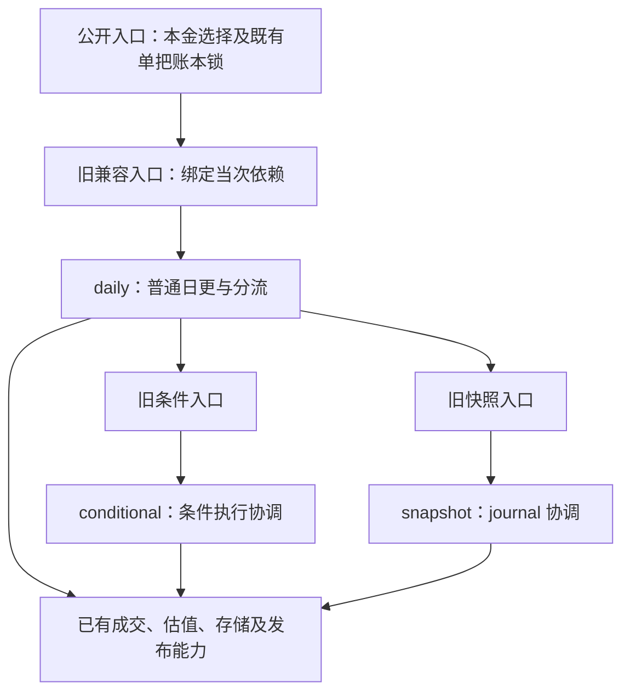

# 策略纸面账的执行协调

这里集中“先检查什么、再成交/估值、何时保存、失败后如何恢复”。三个流程各有一个
入口，保留原有分支和异常边界。交易规则、费用、收益公式、默认成交模式均保持。
所有结果仍为 Research Only / Paper Account Only；没有券商或真实订单路由。

| 要排查的问题 | 先看哪里 | 依赖由谁提供 |
|---|---|---|
| 初始化、普通日更、候选入场、退市处置、转入另外两条流程 | `daily.run` | `DailyPorts` |
| 到期条件计划、分钟证据、重复执行、陈旧观察、复盘绑定 | `conditional.run` | `ConditionalPorts` |
| 下一交易日开盘快照、pending orders、journal 恢复、提交中断 | `snapshot.run` | `SnapshotPorts` |
| 账户本金选择、外层锁、旧路径覆盖、回调适配 | `auto_paper_portfolio.run_auto_paper_portfolio` 及旧私有入口 | 每次调用建立端口 |

`ports.py`只声明显式依赖，不导入执行器、存储或数据读取模块。每条流程的端口按
路径、账本、估值、计划、复盘、发布、风险、时钟等职责分组，只包含它实际使用的项。
旧入口每次调用绑定当前路径、回调与模块对象；没有全局上下文字典或动态属性路由。
`_archive_project_root`、`_auto_paper_state_store`、`_sector_rotation_path`仍是懒回调，
到原调用位置才执行。冻结 dataclass 只冻结字段绑定；共享影子错误列表保持原对象，
`open_fill`和`fill_journal`保持原模块引用。

调用方应继续使用公开入口，它负责锁与本金策略。直接调用新 `run` 不会自动加锁。
已有旧入口 monkeypatch 在下一次调用生效；不保证执行到一半时其他线程替换模块全局
变量的行为。存储与发布没有被改成一个原子事务；出错时必须先查已完成步骤。

## 保存与恢复顺序

**普通日更**：影子风险输出 → 可选波段兼容输出 → state → latest → 仅强制初始化时
删除旧 history → history → report → latest。普通更新和预览不删除历史。
账本已存在但丢失或损坏时，原有拒绝重置现金的保护仍生效。数据/候选检查、卖出释放
现金和买入、T+1及股数规则仍在原顺序。更新转到条件流程前会载入一次账本，条件流程
内部再载入一次；本次没有去除这个重复读取。

**条件执行**：构建下一日计划 → 读取到期计划 → 补齐候选证据 → 检查分钟输入 →
模拟到期计划 → 归档/发布下一日计划 → 应用条件执行 → 复盘和汇总 → 影子风险 →
兼容产物 → 新执行保存 state → 从持久账本建立回执 → 绑定复盘 → 新执行写 latest、
history → report → latest。到期计划不存在时发布“没有到期计划”的空结果，不把
下一日计划拿来成交。同日重复执行跳过 state 和 history，仍可刷新报告与 latest。

陈旧条件分支不重新估值或执行，但非预览时仍写零事件影子摘要、latest、report、
latest。它不是完全不写的分支。`dry_run`保持所有写入关闭，包括影子失败日志；
其内部计算、证据读取和回执构造仍可能执行。

**快照执行**：读取原 state → 核验 journal → 优先处理同日恢复 → 检查信号记录时间窗
→ 处理到期意向及估值 → 校验事务 → journal 提交 → 保存提交返回的 state → 发布。
即使预览也校验新事务，但不提交、不保存、不发布。已提交的同日重放优先于时间窗检查。

journal 提交后 state 或发布失败，不能再成交一遍，也不能撤销已提交 journal。
重试由现有 journal 恢复；state 已同步时只重新发布，缺失/未同步时先恢复 state。
`journal_may_require_recovery=True`表示可能需要核查，不证明提交一定成功。
首次读取/恢复/时钟异常属于 `snapshot_journal_or_clock_invalid`；最终校验/提交/
state/发布异常属于 `snapshot_transaction_incomplete`。中间的报价、撮合、估值异常
继续向外传播，没有被本次迁移改成静默成功。

## 排错步骤

1. 先确认运行的源码版本、成交模式与日期；区分 state、journal 和派生 latest/report。
2. 确定异常发生在哪一步；检查之前的 journal/state 是否已保存。报告缺失不等于成交失败。
3. 缺价格、分钟或日历证据时保留缺失标签；检查原数据，不用合成行情补正式结果。
4. 快照恢复沿用 journal 的一致性检查；普通/条件链也保持其原重复执行保护。
5. 如需回退源码，只回退本批固定文件。运行账本、journal、行情与历史不随源码回退。

合同测试：`tests/test_paper_execution_coordination_20261106.py`。它覆盖调用时绑定、
独立导入、普通/条件保存顺序、失败截断、预览、快照提交/恢复和真实临时 journal
追加后中断。已有金额、价格口径、影子风险、部分卖出、T+1和快照测试继续保留。
金额 AST 测试跟随真正生产函数，影子发布检查核对四处调用及同一归档 sink。

本批是可审阅候选。策略账的报价读取、旧 helper/适配器及部分存储接线仍在旧执行器；
数据层、研究链、AI账、调度、API与页面没有因此全部完成分块。
